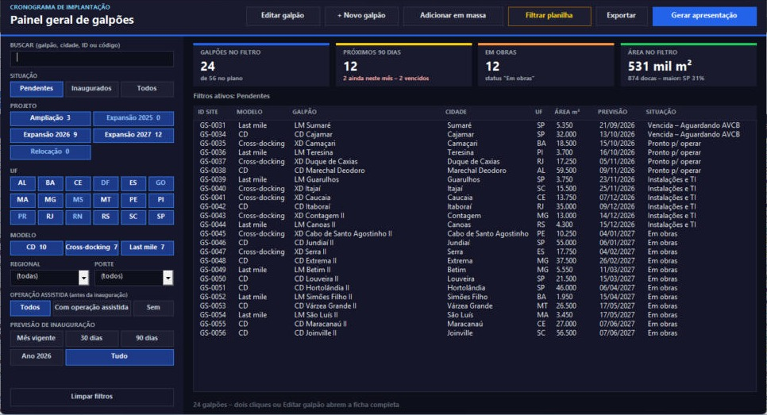
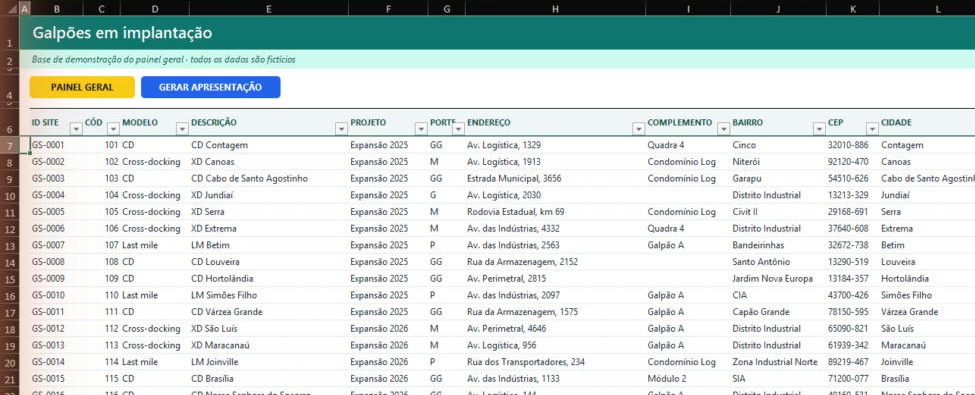
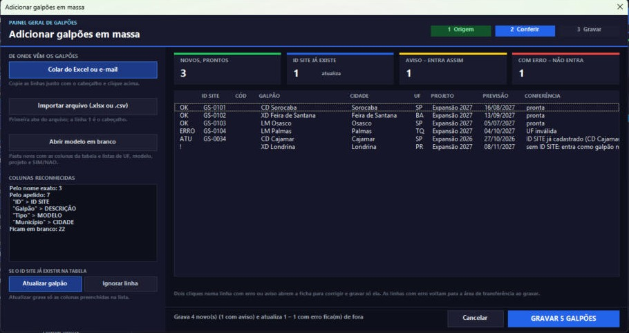
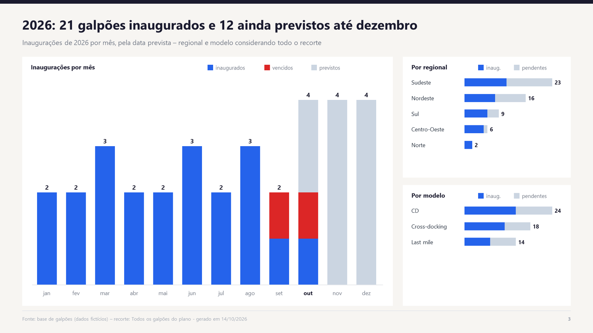
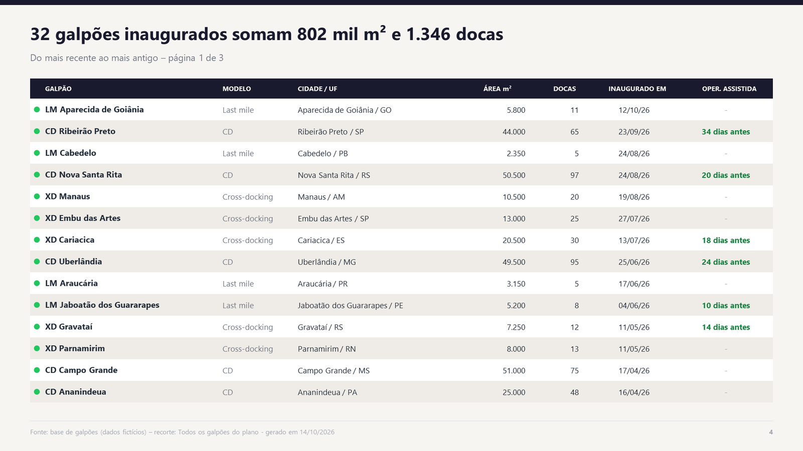
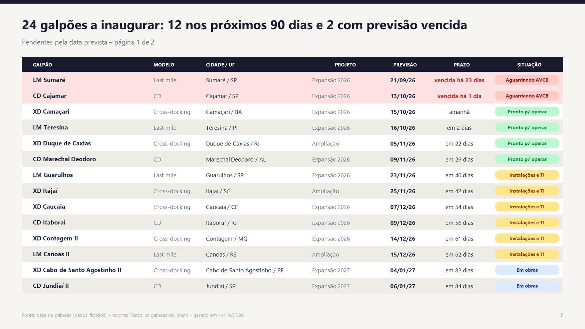

# Painel Geral de Galpões

Um painel em Excel para quem acompanha a implantação de uma carteira de galpões logísticos. A planilha continua sendo a base, mas ninguém precisa rolar dezenas de colunas: o painel filtra, mostra os números que importam, edita um galpão por ficha, inclui vários de uma vez e gera a apresentação no PowerPoint. É VBA puro, sem suplementos e sem banco de dados externo.

> Este repositório é uma vitrine: mostra o que o projeto faz e como foi construído. O código-fonte não é público. Todos os dados são fictícios.

## O que o painel responde

Com a base fictícia (56 galpões entre CDs, cross-dockings e last miles, vista em 14/10/2026):

| Pergunta | Resposta do painel |
|---|---|
| Quantos galpões já operam? | 32 de 56 |
| Quantos inauguram nos próximos 90 dias? | 12, e 2 estão com a previsão vencida |
| Quanto da área já foi entregue? | 802 mil m² entregues e 531 mil m² a entregar |
| Onde está a maior parte da área? | Sudeste, com 46% da área do plano |
| Quem começou a operar antes da inauguração? | 22 galpões, em média 21 dias antes |

## Funcionalidades

- **Filtros combináveis**: situação, projeto, UF, modelo, regional, porte, operação assistida, prazo de inauguração e busca por nome, cidade, ID ou código. Cada botão mostra quantos galpões sobram se for escolhido.
- **Indicadores do filtro**: galpões no filtro, próximos 90 dias (com os vencidos), obras em andamento e área com docas.
- **Ficha do galpão**: edita, inclui e exclui sem abrir a tabela, com navegação pela lista filtrada. Campos alterados ficam marcados, e o SALVAR recusa ID repetido, UF inválida e datas fora de ordem.
- **Inclusão em massa**: cola do Excel ou do e-mail, ou importa um .xlsx/.csv. Reconhece cabeçalhos com outros nomes ("Galpão", "Município", "Área m2"), confere linha por linha e mostra o que entra, o que atualiza e o que tem erro antes de gravar.
- **Filtrar planilha**: aplica o filtro do painel na própria tabela.
- **Exportar**: gera uma cópia da planilha só com as colunas e os galpões escolhidos, no mesmo visual e sem botões.
- **Apresentação no PowerPoint**: 8 tipos de slide, escolhidos em cartões com miniatura, com os galpões do filtro.
- **Colunas pelo nome**: o painel encontra as colunas pelo cabeçalho. Coluna nova ou fora de ordem não quebra nada, e colunas desconhecidas aparecem na ficha numa seção extra.

### A planilha

### Inclusão em massa

### Escolha dos slides

## Apresentação

Os slides seguem o padrão de consultoria: o título é a conclusão, escrita a partir dos números, e cada página trata de um assunto. Tabelas longas são paginadas. Os gráficos são desenhados com formas, sem imagens coladas.

## Como foi construído

| Parte | Papel |
|---|---|
| Camada de dados | Uma classe que lê e grava a tabela, acha as colunas pelo cabeçalho normalizado (sem acento, sem pontuação) e grava só as células alteradas. |
| Formulários | Painel geral, ficha, inclusão em massa, exportação e painel de slides. Todos os controles são criados por código. |
| Classes de eventos | Botões, chips, campos da ficha e cartões de slide são classes com `WithEvents` que repassam o clique ao formulário. |
| Gerador de slides | Lê só os galpões do filtro e desenha cada slide no PowerPoint por ligação tardia, sem referência de biblioteca. |
| Instalador | Um único arquivo .bas que cria módulos, classes e formulários, coloca os botões na aba e salva como .xlsm. Pode rodar de novo para atualizar sem perder os dados. |

## Como foi testado

De ponta a ponta no Excel: instalação pelo .bas, filtros e indicadores, edição e cancelamento na ficha, inclusão em massa com um arquivo de teste (4 novos, 1 atualização, 1 linha recusada por UF inválida), filtro na planilha, exportação e geração da apresentação com o plano inteiro e só com os pendentes.

## Autor

**Davi Lima**, Analista de Planejamento no PMO de Expansão.
[LinkedIn](https://www.linkedin.com/in/davi-lima-362723214/)
